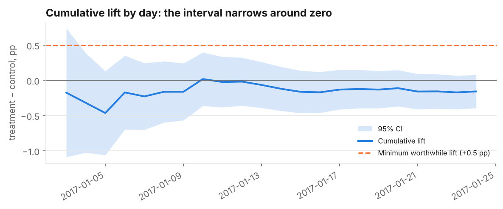
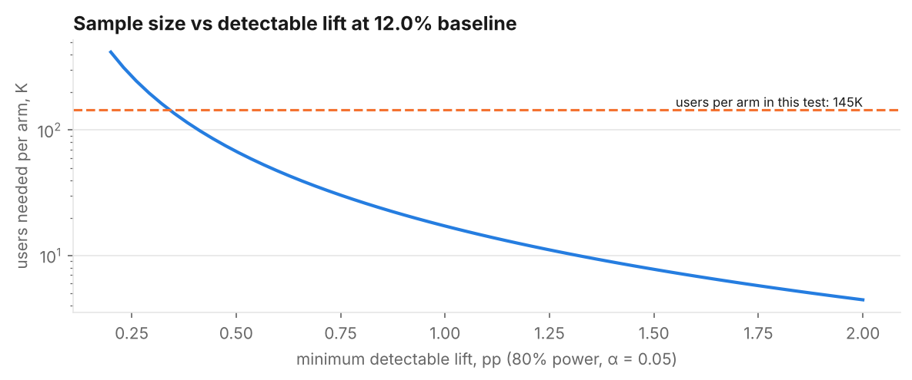

# A/B Test Read-out: New Landing Page

**Should an e-commerce site replace its landing page?** This repo is a complete experiment read-out: data checks, power analysis, the result with a confidence interval, a segment check, and a decision taken from rules written *before* the result was read.

**Run it on Kaggle:** [AB Test Read-out: Power, CI and Decision Rules](https://www.kaggle.com/code/timachan/ab-test-read-out-power-ci-and-decision-rules)



## Problem
290K users were randomly shown the old or the new landing page for 3 weeks. Product wants to know whether to ship the new page.

## Approach
1. **Data checks.** Removed 3,893 rows where the group and the page shown didn't match, plus 1 duplicate user. A **sample-ratio mismatch** test (χ², p = 0.95) confirms the 50/50 split held.
2. **Decision rules first** ([DECISION_RULES.md](DECISION_RULES.md)). The minimum worthwhile lift is +0.5 pp, with α = 0.05 and 80% power, which requires **67,673 users per arm**.
3. **Result.** Difference in proportions with an unpooled 95% CI, a z-test, and the Bayesian probability that the new page is better.
4. **Segments.** A logistic regression with treatment × country tests whether the effect differs in the US, UK, or CA.

## Result
| | Old page | New page |
|---|---|---|
| Users | 145,274 | 145,310 |
| Conversion | 12.04% | 11.88% |

- Lift **−0.16 pp** (−1.3%), 95% CI **[−0.39, +0.08] pp**, p = 0.19. P(new page better) = 9.5%.
- No country behaves differently (interaction p = 0.24 for UK, 0.38 for CA).
- The test had 2× the users it needed, so it could detect lifts down to **0.34 pp**.

**Decision: do not ship.** The upper end of the CI (+0.08 pp) is far below the +0.5 pp worth shipping, and the test was well powered. My original analysis suggested "run it longer"; the power analysis shows that wouldn't change the answer.



## Run it
```bash
pip install -r requirements.txt
python abtest.py
```

## Files
```
abtest.py                 # read-out: checks, power, result, segments, decision
DECISION_RULES.md         # pre-registered metric, MDE, α, power, ship / no-ship rules
figures/                  # charts above
notebook/                 # original analysis (Udacity project)
ab_data.csv, countries.csv
```
